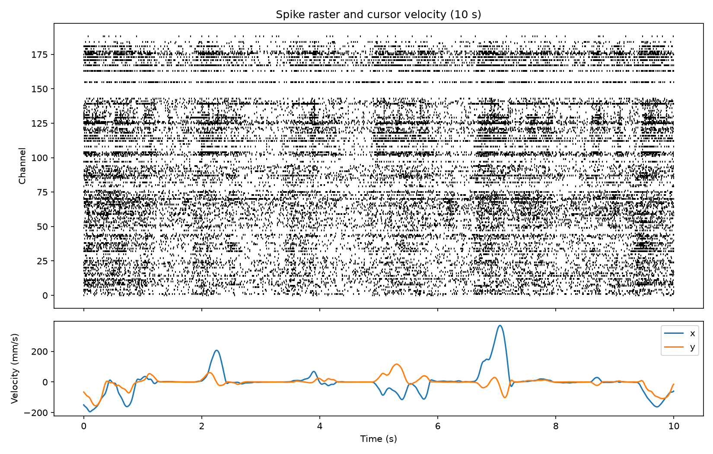

# Real-time neural decoder on a Pico 2

Decoding cursor velocity from motor cortex spikes, first offline in Python, then in real time in fixed-point C on the RISC-V cores of a Raspberry Pi Pico 2.

**Status:** week 1 of 22. Offline phase. Data loading and binning done; first decoder baseline is next.



## Why

An implanted brain-computer interface has to detect spikes and decode intent on a small, low-power chip, within a few milliseconds, every time. This project builds a small version of that chain end to end, on a microcontroller core with no floating point unit, to learn where the hard parts are.

## Results so far

| Date | Stage | Metric | Value |
|---|---|---|---|
| 2026-10-05 | Data | Session `indy_20160407_02` | 818 s, 141 of 192 channels kept, 16,355 bins at 50 ms, 18.9 Hz mean rate |

The full list, with the commit behind each number, is in [docs/results.md](docs/results.md).

## Plan

| Phase | What | Target |
|---|---|---|
| 1. Offline decoding | Ridge and Kalman baselines, small neural network comparison, second dataset | October to November 2026 |
| 2. Fixed-point study | Quantise the Kalman filter in Python, then C on a laptop, tested against Python | Late November to December 2026 |
| 3. On-device | Spike detection and decoding on the Pico 2 under FreeRTOS, split across both cores | December 2026 to January 2027 |
| 4. Closed loop | Host replays recordings to the Pico and draws the decoded cursor | Late January 2027 |

## Documentation

| File | What it holds |
|---|---|
| [docs/origin.md](docs/origin.md) | Where the idea came from and what the project is for |
| [docs/decisions.md](docs/decisions.md) | Every design choice, the reason, and the alternative rejected |
| [docs/results.md](docs/results.md) | Every headline number and the commit that produced it |
| [docs/log/](docs/log/) | One entry per week: done, numbers, what broke, what I learned |
| [docs/sessions.md](docs/sessions.md) | Three lines per working session |
| [docs/questions.md](docs/questions.md) | Open questions and parked ideas |

## Set up and reproduce

```bash
python3 -m venv .venv && source .venv/bin/activate
pip install -r requirements-dev.txt

# Download indy_20160407_02.mat (about 420 MB) into data/
curl -L -o data/indy_20160407_02.mat \
  "https://zenodo.org/records/583331/files/indy_20160407_02.mat?download=1"

python python/load_sabes.py data/indy_20160407_02.mat
```

This writes `data/indy_20160407_02_binned.npz` (spike counts and velocity) and the raster above.

## Checks

```bash
ruff check .
pytest -q
```

The same two commands run on every push to `main`.

## Layout

```
python/     offline analysis and decoders
tests/      checks that run without the recordings
firmware/   C for the Pico 2 (from phase 2)
docs/       origin, decisions, results, logs
figures/    plots referenced by the docs
data/       recordings (not committed)
```

## Data

O'Doherty, J. E., Cardoso, M. M. B., Makin, J. G., and Sabes, P. N. (2017). *Nonhuman Primate Reaching with Multichannel Sensorimotor Cortex Electrophysiology.* Zenodo. https://doi.org/10.5281/zenodo.583331

## Use of AI tools

The core signal chain and fixed-point maths are written by hand. AI assistance is used for plumbing (such as file loading) and for code review, and is noted in the log where used.
